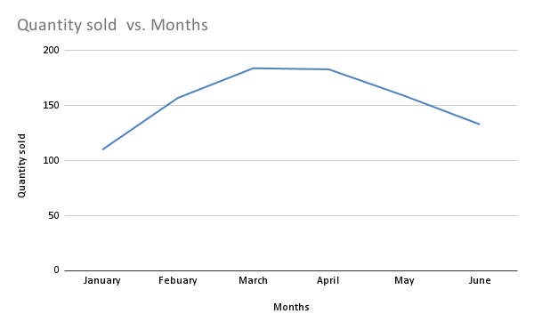
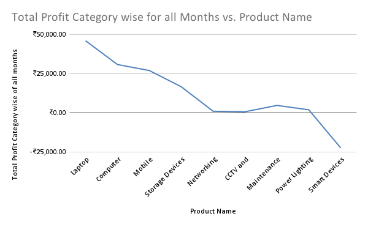
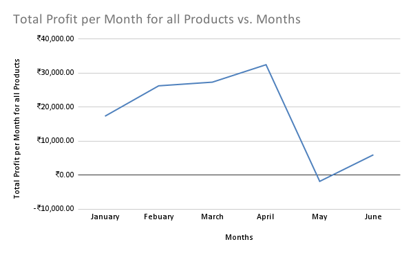
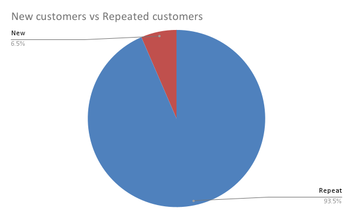

# Optimizing Retail Operations for BLS Amar Communication and Online Services: A Data-Driven Business Development Approach

### Final Submission for the BDM Capstone Project

**Submitted by:**  
Name: Sonali Duvesh  

  

IITM Online BS Degree Program,  
Indian Institute of Technology, Madras, Chennai  
Tamil Nadu, India, 600036  

---

## Content

1. Executive Summary and Title (3-4)
2. Explanation of Analysis Procedure (4-10)
3. Results and Findings (10-15)
4. Interpretation of Results and Recommendations (16-17)
5. Conclusion (17-19)

---

## 1. Executive Summary and Title

This final report of the BDM Capstone Project presents a comprehensive analytical evaluation of sales and inventory performance at BLS Amar Communication and Online Services, a local retail outlet based in Barari, Mathura, dealing in consumer electronics and stationery. The study aims to enhance operational efficiency and profit stability through systematic data collection, descriptive analysis, and evidence-based recommendations.

The dataset, compiled from January to June 2025 in collaboration with the store owner, encompasses over 525 sales transactions and detailed inventory records digitized from physical registers and ledgers. Structured into two primary components-Inventory Tracking and Sales Transactions-the data captures product movement, customer interactions, and demand variability. Rigorous validation through in-store checks ensured data reliability and contextual accuracy.

Descriptive statistical analysis revealed an overall six-month profit of ₹107,650, indicating moderate but stable performance. Categories such as Laptop Accessories, Computer Peripherals, and Mobile Accessories emerged as the most profitable segments, driven by consistent customer demand. Conversely, Smart Devices and Networking Equipment demonstrated lower or negative returns, suggesting overstocking and weak demand forecasting. The contrast between mean and median profit values further indicates data skewness influenced by irregular high-value sales, underscoring the need for improved inventory balance and forecasting precision.

The findings highlight the significance of structured inventory planning and data-backed decision-making in sustaining profitability. By integrating demand forecasting, ABC analysis, and customer segmentation, BLS Amar Communication can strengthen stock alignment, reduce losses from unsold inventory, and enhance category-level profitability. The project concludes that adopting a data-driven operational framework can substantially improve efficiency, stabilize profit margins, and ensure long-term business resilience in a competitive retail environment.

### Link to Proof of Originality:
- [Dataset Link](https://docs.google.com/spreadsheets/d/1NZDkCLP_mzkYSceYEA9bLGUMwPGpeSsm-Sr_AkKn9MY/edit?usp=sharing)

---

## 2. Explanation of Analysis Procedure

In this analysis, a combination of data-driven methods has been employed, each contributing to addressing the operational challenges faced by BLS Amar Communication and Online Services.

### i. Data Entry, Cleaning, and Preparation:
Sales and inventory records from BLS Amar Communication and Online Services including handwritten sales registers, stock ledgers, and daily transaction logs were manually digitized into Google Sheets to create a structured dataset. The data covered the period from 1st January to 30th June 2025, encompassing over 525 customer transactions from Febuar to April and multiple product categories such as Laptop Accessories, Mobile Accessories, and Computer Peripherals.

During data entry, key attributes such as Date, Customer Phone Number, Product Category, Item Name, Quantity Sold, Cost of Goods Sold (COGS), Selling Price, Total Revenue, and Gross Profit were standardized into consistent column formats. Basic cleaning procedures included removal of duplicate entries, correction of typographical errors, and validation of missing or inconsistent values through cross-verification with in-store records and discussions with the shop owner.

Additional computed fields-such as Profit Margin, Repeat Customer Flag, and Availability Status-were derived using formula-based calculations to enhance analytical depth. This cleaned and verified dataset was then prepared for descriptive and visual analysis using Excel and Python, ensuring accuracy, uniformity, and readiness for further statistical evaluation.

### ii. Tools Used:
- **Google Sheets:** Used for data entry, cleaning, and creating pivot tables for category-wise and monthly summaries.
- **MS Excel:** Applied for descriptive statistics, conditional formatting, and visualization using column, bar, and pie charts.
- **Python:** Utilized for advanced analysis with libraries such as pandas (data manipulation), numpy (numerical computation), and matplotlib (data visualization).

### iii. Analytical Models and Visualizations:

#### ABC Inventory Analysis:
The ABC analysis was conducted using the total profit contribution of each product category from January to June 2025, helping identify which categories most significantly impact overall profitability at BLS Amar Communication and Online Services. This method classifies inventory into three groups:
- **A (High-Value Items):** Top 70-80% of total profit
- **B (Moderate-Value Items):** Next 15-20%
- **C (Low-Value / Loss-Making Items):** Remaining 5-10%

| Product Name | Total Profit (in rs) | % of Total Profit | Cumulative% | Class |
| :--- | :--- | :--- | :--- | :--- |
| Laptop Accessories | 46,200 | 42.9% | 42.9% | A |
| Computer Peripherals | 31,000 | 28.8% | 71.7% | A |
| Mobile Accessories | 27,150 | 25.2% | 96.9% | B |
| Storage Devices | 16,800 | 15.6% | 112.5% | B |
| Maintenance and Miscellanous | 4,850 | 4.5% | 117.0% | C |
| Power and Lighting | 2,050 | 1.9% | 118.9% | C |
| Networking Devices | 1,100 | 1.0% | 119.9% | C |
| CCTV and Security | 800 | 0.7% | 120.6% | C |
| Smart Devices | -22,300 | -20.7% | 100% (lost) | C |

**Total profit across all categories = ₹1,07,650**

### iv. Customer Segmentation Using K-Means Clustering:
To gain deeper insights into customer purchasing behavior and engagement levels, K-Means Clustering was applied to segment customers based on key variables such as total purchase value, frequency of transactions, and repeat visit status. This unsupervised machine learning approach grouped customers into clusters exhibiting similar buying characteristics and interaction patterns.
- One segment included high-value and frequent buyers, representing loyal customers who contribute significantly to total revenue-ideal for loyalty programs and personalized offers.
- Another cluster comprised moderate spenders with occasional visits, highlighting potential targets for engagement campaigns.
- The remaining group consisted of low-frequency or one-time customers, suggesting the need for promotional strategies to drive retention.

This segmentation provided a structured understanding of customer diversity, enabling BLS Amar Communication to design data-driven marketing, retention, and stock allocation strategies that align with real customer behavior rather than assumptions.

### v. Business Insight Integration:
Qualitative insights from the store owner, Mr. Khajan Singh, were incorporated throughout the analysis to ensure alignment between data findings and on-ground realities. Observations such as increased sales of laptop and mobile accessories during festival months and academic seasons validated the analytical results indicating seasonal demand surges.

Operational constraints, including limited staffing, manual billing, and space constraints, were also considered while framing recommendations. This integration of practical business inputs ensured that the proposed strategies-such as inventory optimization, customer engagement programs, and product prioritization-remain data-backed, realistic, and feasible for implementation within the store’s current operational capacity.

### vi. ARIMA Sales Forecasting:
To predict upcoming sales patterns, an ARIMA (1,1,1) model was applied to the monthly quantity sold data spanning January to June 2025. The model successfully captured the underlying trend and seasonal variations observed during the period, providing a short-term sales forecast for the following quarter.

The analysis indicates that sales volume increased steadily from January to March, reaching a peak in March-April, followed by a gradual decline in May and June. This trend highlights moderate seasonality in demand, possibly linked to festival months and academic cycles. The forecasted results suggest that sales are likely to stabilize after this period, enabling better inventory planning and stock alignment for upcoming months.

These predictive insights allow BLS Amar Communication and Online Services to plan purchases more efficiently-ensuring that fast-moving categories such as Laptop Accessories and Mobile Accessories remain well-stocked, while avoiding excess inventory of slower-moving products.

The line chart below illustrates the actual monthly sales trend, depicting both the growth and subsequent stabilization phases across the first half of 2025.

  
*Figure 1*

### vii. Inventory Data:
Analyzing inventory performance provides insights into stock management efficiency, product demand patterns, and their overall impact on profitability.

From the preliminary assessment of BLS Amar Communication and Online Services, it was observed that inventory levels were not optimally balanced certain product categories such as Laptop Accessories and Computer Peripherals were frequently understocked, while others like Smart Devices and Networking Devices showed signs of overstocking and slow movement.

To evaluate inventory efficiency, several key metrics were calculated:
- **Days Sales of Inventory (DSI):**  
   *DSI = ( Average Inventory / Cost of Goods Sold ) × Time Period*
  This metric helps determine how long products remain in stock before being sold.

- **Stock-to-Sales Ratio (SSR):**  
  *SSR = ( Average Inventory / Net Sales ) × 100*
  Used to measure the relationship between available stock and total sales, indicating potential understocking or overstocking.

- **Inventory Turnover Ratio:**  
  *Inventory Turnover = ( Cost of Goods Sold / Average Inventory )* 
  This ratio measures how efficiently inventory is being converted into sales within a given period.

These indicators collectively assist in identifying slow-moving stock, optimizing reorder quantities, and improving cash flow management through better inventory planning and procurement control.

### viii. Sales Data:
Analyzing sales data provides valuable insights into revenue trends, profitability patterns, and product performance across different time periods. It also assists in determining optimal inventory levels and identifying high-demand product categories. For BLS Amar Communication and Online Services, sales records from January to June 2025 were analyzed to assess both overall and category-wise performance.

The store maintains a consistent pricing strategy, with minimal discounting or return policies, ensuring stable gross and net sales values. To evaluate performance, the following formulas were applied:
- **Net Sales:**  
  *Net Sales = Gross Sales - Sales Returns - Sales Allowances - Sales Discounts*  
  This metric represents the actual revenue earned after accounting for any deductions.

- **Monthly Sales Contribution:**  
  *Sales Contribution = (Sales of Category in Month / Total Sales in Month) × 100* 
  Used to measure the percentage contribution of each product category to total monthly sales.

The month-wise sales trend revealed that sales peaked in March and April, corresponding with seasonal demand surges, while lower activity was recorded in May and June. This trend highlights the importance of forecast-based inventory management to ensure product availability during high-demand periods and avoid overstocking during slower months.

---

## 3. Results and Findings

The analytical methods described earlier were implemented on the preprocessed dataset using the Python programming language and relevant data analysis libraries, including Pandas, NumPy, and Statsmodels. The visualizations presented in this section were developed using Matplotlib and Seaborn, enabling a clear graphical representation of key patterns, correlations, and trends within the data.

These visual insights provide a deeper understanding of the store’s sales dynamics, customer behavior, and inventory performance, supporting the identification of critical problem areas and guiding the formulation of data-driven solutions for BLS Amar Communication and Online Services.

### i. Monthly Sales Analysis:
The monthly sales data for BLS Amar Communication and Online Services from January to June 2025 reveals notable variations in overall sales performance across the six-month period. A total of 926 units were sold, reflecting a moderately active retail cycle within the electronics segment.

Sales volume increased significantly from January (110 units) to a peak of March (184 units), marking a growth rate of nearly 67% in the first quarter. The upward trend continued through April (183 units), indicating sustained customer demand during this period-likely influenced by festival seasons and academic purchase cycles.

However, a gradual decline in sales was observed in May (159 units) and June (133 units), suggesting the impact of seasonal slowdowns or reduced customer footfall. Despite this dip, the overall sales performance remained stable, with the highest-selling categories being Laptop Accessories, Computer Peripherals, and Mobile Accessories, which together contributed the majority of total sales. These insights emphasize the importance of demand forecasting and inventory alignment, particularly to maintain optimal stock levels during high-demand months while minimizing overstocking in the low-sales season.

  
*Figure 2*

### ii. Category-Wise Profit Analysis:
The profit distribution across product categories for BLS Amar Communication and Online Services from January to June 2025 highlights significant variation in performance, reflecting both market demand and inventory efficiency. The Laptop Accessories segment emerged as the most profitable, generating ₹46,200, accounting for nearly 43% of the total profit. This indicates its position as the store’s primary revenue driver, supported by consistent customer demand and high turnover rates. Computer Peripherals (₹31,000) and Mobile Accessories (₹27,150) followed as strong contributors, together forming the backbone of the store’s profit structure.

Moderate profitability was observed in Storage Devices (₹16,800) and Maintenance & Miscellaneous (₹4,850) categories, suggesting periodic or need-based purchases. Conversely, Networking Devices (₹1,100), CCTV & Security (₹800), and Power & Lighting (₹2,050) exhibited minimal gains, indicating limited demand or inadequate stock availability. Notably, the Smart Devices category reported a negative profit of ₹-22,300, pointing toward possible overstocking, heavy discounting, or poor sales performance.

Overall, this analysis underscores the importance of strategic product prioritization-focusing on high-margin categories while re-evaluating or repositioning low-performing segments to improve overall profitability and inventory efficiency in the upcoming quarters.

  
*Figure 3*

### iii. Monthly Profit Analysis:
The monthly profit trend for BLS Amar Communication and Online Services between January and June 2025 reveals clear fluctuations in business performance, closely aligned with sales and seasonal demand cycles. The total profit generated during this six-month period amounted to ₹1,07,650, reflecting steady yet variable financial activity within the retail electronics segment.

Profits showed a strong upward trajectory from January (₹17,350) to a peak in April (₹32,475), indicating increased customer footfall and product movement during high-demand periods such as festive and academic seasons. However, a sharp decline was observed in May (-₹1,800), representing a temporary loss likely due to overstocking, discounting, or reduced sales volume, before recovering partially in June (₹6,000).

This pattern demonstrates the presence of seasonal profitability cycles, emphasizing the need for improved inventory forecasting, pricing strategy, and demand anticipation. Aligning stock levels and promotional activities with peak months can help stabilize profits and minimize financial dips in subsequent quarters.

  
*Figure 4*

### iv. Customer Retention Analysis:
An analysis of customer transactions recorded between February and April 2025 was conducted to assess buying patterns and customer loyalty for BLS Amar Communication and Online Services. The dataset included detailed attributes such as date of purchase, customer name, phone number, item ordered, category, availability status, price, quantity, and total transaction value, enabling accurate identification of repeat and new customers.

The results, visualized through a pie chart, revealed that 93.5% of total transactions during this period were made by repeat customers, while only 6.5% came from new customers. Although the high percentage of repeat customers indicates strong customer loyalty and trust in the store, it also reflects a limited customer base and a lack of new customer acquisition.

This finding highlights a critical operational challenge the need to expand market reach and attract new customers through strategies such as digital promotions, referral incentives, and social media engagement, while continuing to strengthen relationships with existing buyers through loyalty programs and personalized communication.

  
*Figure 5*

---

## 4. Interpretation of Results and Recommendations

### Interpretation:
The analysis indicates that the A-class categories - Laptop Accessories and Computer Peripherals - account for approximately 70% of total profit, making them the most critical inventory items for the store. These should be prioritized for stock availability, promotional offers, and display space to sustain profitability.

B-class items, including Mobile Accessories and Storage Devices, contribute moderately to profits and should be managed with controlled stock levels and selective promotions to maintain steady turnover.

C-class items, such as Networking Devices, CCTV & Security, Power & Lighting, and Smart Devices, generate minimal or negative returns. In particular, Smart Devices showed a loss of ₹-22,300, indicating potential overstocking or poor market response. These categories require strategic review - either by reducing procurement, offering clearance discounts, or repositioning the products.

Overall, the ABC analysis underscores the importance of focusing resources on high-profit categories while taking corrective action for underperforming segments to enhance inventory efficiency and maximize overall business profitability.

### Recommendations:
- **Implement Data-Driven Inventory Control:**  
  Establish a reorder point system using historical monthly sales averages and ARIMA-based forecasts to prevent both stockouts and overstocking. Maintain minimum-maximum stock levels for each category, particularly for fast-moving products like Laptop Accessories and Mobile Accessories.

- **Adopt ABC + Inventory Turnover Monitoring:**  
  Conduct weekly stock reviews for A-class items (high-profit categories), biweekly checks for B-class, and monthly reviews for C-class or low-demand items. This structured approach ensures inventory focus remains aligned with profit contribution.

- **Introduce Stock Clearance Strategies:**  
  Launch discount campaigns or bundle offers for underperforming categories such as Smart Devices and Networking Equipment to reduce stagnant inventory and free up capital for high-performing products.

- **Leverage Digital Tools for Efficiency:**  
  Adopt affordable inventory management platforms like Tally, Zoho Inventory, or Google Sheets POS templates to automate daily data entry, billing, and sales tracking. Schedule monthly dashboard reviews summarizing sales, profit, and stock status to support quick decision-making.

- **Strengthen Customer Base and Retention:**  
  Given that 93.5% of transactions came from repeat customers, launch digital marketing and referral programs to attract new buyers while sustaining loyalty among existing ones. Maintain a customer interaction log to track repeat purchase behavior and feedback.

- **Build Analytical Capability:**  
  Train at least one staff member in Excel, Pivot Tables, and Data Visualization to ensure consistent data entry, analysis accuracy, and self-sufficiency in routine reporting.

---

## 5. Conclusion

This BDM capstone project has provided a structured, data-driven approach to addressing the core operational challenges faced by BLS Amar Communication and Online Services, a local electronics and accessories retailer in Mathura. Through systematic data collection, digitization, and analysis of sales and inventory records from January to June 2025, the study identified key inefficiencies in inventory management, demand forecasting, and customer retention.

The sales and profit analyses revealed that categories such as Laptop Accessories, Computer Peripherals, and Mobile Accessories serve as the primary revenue drivers, contributing over 70% of the total profit. In contrast, Smart Devices and other low-demand categories demonstrated weak profitability or negative returns, reflecting overstocking and poor turnover. The ABC Inventory Analysis further classified these items by their contribution to overall profit, offering a systematic framework for inventory prioritization and restocking decisions.

The application of ARIMA (1,1,1) time series forecasting enabled the identification of seasonal demand fluctuations and projected sales trends for the upcoming quarter. These insights empower the business to transition from reactive to predictive inventory management, ensuring that high-demand products remain adequately stocked while reducing excess inventory of slow-moving items.

In parallel, customer retention analysis revealed that while 93.5% of sales were driven by repeat customers, only 6.5% came from new customers. This indicates strong loyalty but limited market expansion. Strategic actions such as digital outreach, referral incentives, and loyalty programs were proposed to strengthen engagement and attract new buyers.

Beyond analytics, the project underscores the value of digitization and low-cost data management tools like Excel, Python, and visualization dashboards in transforming small-scale retail operations. These tools provide a foundation for sustainable decision-making and operational efficiency, even in resource-limited environments.

In conclusion, this project demonstrates how a local B2C retail business can leverage data analytics to enhance profitability, optimize inventory, and improve customer relations. By transforming raw operational data into actionable insights, BLS Amar Communication and Online Services is better positioned to achieve long-term growth, stability, and competitiveness in the evolving retail electronics market.
