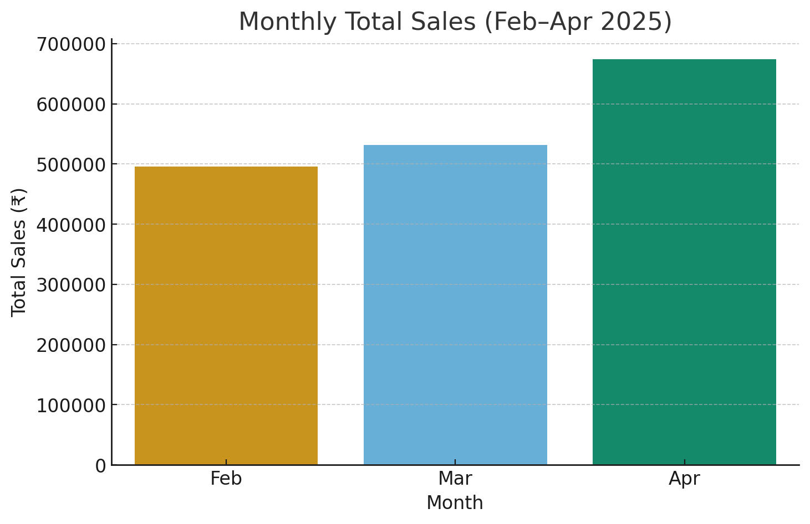
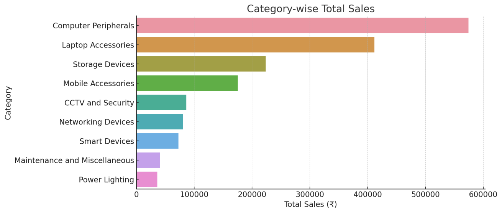
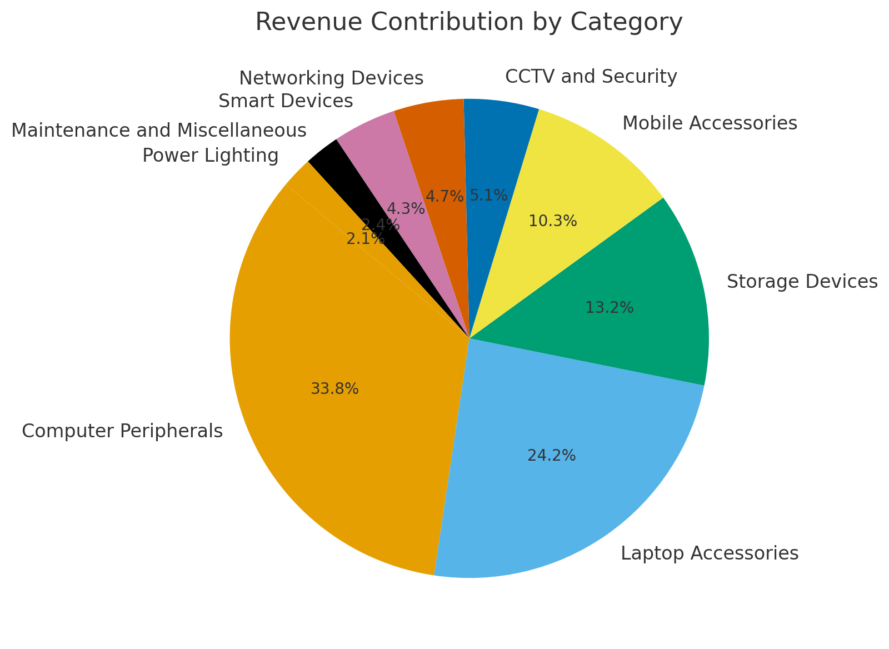

# Optimizing Retail Operation for BLS Amar Communication and Online Services: A Data-Driven Business Development Approach

### A Mid-term submission for the BDM Capstone Project

**Submitted by**  
Name: Sonali Duvesh  

  

IITM Online BS Degree Program, Indian Institute of Technology, Madras, Chennai Tamil Nadu, India, 600036  

---

## Content

1. Executive Summary (3)
2. Proof of Originality (3-4)
3. Metadata (4-5)
4. Descriptive Statistics (5-6)
5. Analysis process and Methods (6-7)
6. Results and Findings (7-10)

---

## 1. Executive Summary

This capstone project focuses on optimizing retail operations at BLS Amar Communication and Online Services, a family-run electronics and accessories store located in Barari, Mathura. Despite serving a loyal local customer base since 2018, the business faces persistent challenges related to inefficient inventory management, inconsistent sales, and low customer retention. These operational gaps often lead to stockouts of high-demand items, overstocking of slow-moving products, and missed opportunities for repeat business.

Using real-world sales data collected from January to June 2025, this project applies datadriven strategies to uncover patterns in demand, customer behavior, and product performance. Preliminary analysis reveals significant fluctuations in daily sales and frequent unavailability of popular items like SSDs, Bluetooth devices, and laptop accessories-pointing to a lack of demand forecasting and structured stock tracking.

To address these issues, the project employs tools like Excel and Python for descriptive and diagnostic analysis, while visualization techniques help communicate key insights. Repeat customer trends, item-wise revenue contributions, and unfulfilled requests are mapped to guide operational improvements.

The expected outcome is a more reliable and efficient inventory system, better product availability, and increased customer engagement-laying the groundwork for sustainable growth and profitability for BLS Amar Communication in a highly competitive retail environment.

---

## 2. Proof of Originality

**a. Letter from Organization**  

**b. Images of the Organization**  

**c. Interaction video with Owner**  

---

## 3. Metadata

**Dataset Link**  
- [https://docs.google.com/spreadsheets/d/1NZDkCLP_mzkYSceYEA9bLGUMwPGpeSsm-Sr_AkKn9MY/edit?usp=sharing](https://docs.google.com/spreadsheets/d/1NZDkCLP_mzkYSceYEA9bLGUMwPGpeSsm-Sr_AkKn9MY/edit?usp=sharing)

### i) Origin of the Dataset
The dataset was collected from BLS Amar Communication and Online Services, a local electronics and accessories retailer based in Barari, Mathura. During multiple visits between January and June 2025, I collaborated directly with the store owner, Mr. Khajan Singh, to digitize physical records such as handwritten sales registers and stock ledgers. This raw information-spanning real-time customer transactions, inventory status, and daily sales patterns-was manually transcribed into structured Google spreadsheets. Each entry was validated through in-store inventory checks and discussions with the shopkeeper to ensure accuracy and contextual alignment. This hands-on approach not only ensured data quality but also offered deeper insights into the practical challenges of inventory and sales operations in a semi-digital retail environment.

### ii) Dataset Structure and Description
The data comprises two main components:

#### 1. Inventory Tracking Outline
An evolving dataset intended for deeper inventory analysis. It is structured month-wise (January to June), and includes:
- **Product Category & Name:** Classified by type (e.g., Laptop Accessories, Storage Devices).
- **Opening Stock:** Items available at the beginning of the month.
- **Quantity Purchased / Sold:** Stock inflow and outflow within the month.
- **Closing Stock:** Remaining items at month-end.

#### 2. Sales Transaction Data
Covers 525 transactions from Febuary to April2025, with the following key variables:
- **Date:** The exact day the transaction took place.
- **Customer Name & Phone Number:** Identifies the buyer; used to track repeat visits.
- **Item Purchased:** The name of the product sold.
- **Quantity & Price per Item:** Number of units purchased and their unit price (in INR).
- **Total Price:** Computed as Quantity × Price per Item.
- **Item Availability:** Indicates whether the product was available at the time of request (Yes/No).
- **Day:** Weekday name derived from the transaction date.
- **Repeat by Name / Repeat by Phone:** Flags whether the customer has visited previously.
- **2 successful queries**

---

## 4. Descriptive Statistics

The descriptive analysis of the sales and profit data for the period January to June 2025 provides valuable insights into the operational and financial performance of BLS Amar Communication and Online Services. The overall profit earned during the six-month period amounted to ₹107,650.00, reflecting moderate but steady business activity within the retail electronics sector.

Across categories, the Laptop Accessories segment emerged as the most profitable, with a mean profit of ₹6,300.00 and a median of ₹7,700.00, indicating consistent high sales and strong customer demand. This suggests that laptop-related components remain the store’s primary revenue driver, supported by recurring customer purchases. Similarly, Computer Peripherals (mean ₹5,600.00) and Mobile Accessories (mean ₹5,100.00) contributed significantly to the overall profit, highlighting their steady market performance and essential nature in consumer electronics.

Mid-range categories such as Storage Devices (mean ₹2,850.00) and Maintenance & Miscellaneous (mean ₹750.00) showed moderate profitability, likely driven by periodic or need-based purchases. In contrast, Networking Devices (mean ₹1,100.00) and CCTV & Security (mean ₹1,400.00) exhibited comparatively lower mean and median profits, suggesting either limited market demand or inadequate stock availability during high-demand periods.

Notably, Smart Devices recorded a negative median profit of ₹-3,716.67, indicating potential overstocking, poor sales performance, or heavy discounting to clear old inventory. This category warrants strategic review to assess pricing, stock rotation, and marketing initiatives.

The variation between mean and median profits across categories also indicates data skewness, implying that certain high-value transactions may have disproportionately influenced averages. This reinforces the importance of consistent stock tracking and demand forecasting to stabilize profit margins.

Overall, the descriptive analysis emphasizes that while BLS Amar Communication has a strong foothold in core accessory segments, there exists an opportunity to optimize underperforming categories through targeted promotions, better stock planning, and customer-driven assortment strategies. A data-backed approach to inventory and pricing could further enhance profit consistency and operational efficiency in upcoming quarters.

---

## 5. Analysis Process and Methods

The analysis process began with the systematic collection of sales data from BLS Amar Communication and online Services spanning 1st January 2025 to 30th June 2025. The data was then cleaned and structured in Google Sheets to ensure accuracy and reliability. This crucial step involved verifying the dataset for inconsistencies, missing values, and duplicates, while organizing the information into columns such as Date, Customer Phone Number, Category, Product, Quantity Sold, Cost of Goods Sold (COGS), Selling Price, Total Revenue, and Gross Profit.

The dataset encompassed nine distinct product categories: Laptop Accessories, Computer Peripherals, Mobile Accessories, Storage Devices, Networking Devices, CCTV and Security, Maintenance and Miscellaneous, Power and Lighting, and Smart Devices. This comprehensive categorization enabled detailed analysis of performance across different product segments within the electronics retail sector.

Descriptive statistical techniques-including mean, median, mode, standard deviation, and range-were applied to multiple metrics such as quantity sold, COGS, selling price, and gross profit. These analyses uncovered key insights about customer preferences, revenue trends, profitability patterns, and variability in performance across product categories. Additionally, customer behavior analysis was conducted using phone number data to identify repeat customers, calculate customer retention rates, and understand purchasing patterns.

For visual representation, several chart types were employed to highlight important patterns and trends effectively. Clustered column charts compared monthly revenue and gross profit across categories, showcasing profitability trends and identifying the top-performing months. Line marker charts tracked fluctuations in revenue and profit margins over time, revealing peak demand periods and changes in customer behavior. Pie charts were utilized to illustrate the percentage contribution of each category to total revenue and profit, while bar charts outlined monthly expenses and COGS distribution, offering a clear understanding of cost structures and opportunities for optimization. These visualizations made it easier to interpret the data and communicate findings clearly.

Google Sheets' features, including pivot tables, conditional formatting, and advanced formulas (such as COUNTIF for repeat customer analysis and profit margin calculations), facilitated a structured and interactive exploration of the dataset. This systematic approach enabled the identification of trends, patterns, and actionable insights, empowering BLS Amar and Communication Services to optimize its inventory management, pricing strategies, and customer engagement efforts for sustained profitability in the competitive electronics retail market.

---

## 6. Results and Findings

### 6.1 Monthly Sales Trend (Feb-Apr 2025)
- The sales show a steady upward trend from February to April 2025.
- February had the lowest sales volume, which gradually increased in March and peaked in April.
- The spike in April corresponds with a higher number of active customers (around 100), indicating improved customer reach and demand recovery.
- The data suggests growing awareness and repeat purchases in later months.

  
*Figure 1*

### 6.2 Category-wise Total Sales
- Laptop Accessories and Computer Peripherals recorded the highest total sales, making them the core revenue drivers of the store.
- Mobile Accessories and Storage Devices performed moderately well, showing consistent demand.
- Lower sales were observed in Smart Devices, Power Lighting, and Maintenance & Miscellaneous, indicating limited movement or niche interest.
- The results imply a clear product hierarchy, where top categories dominate revenue contribution.

  
*Figure 2*

### 6.3 Revenue Contribution by Category (Pie Chart)
- The top three categories - Laptop Accessories, Computer Peripherals, and Mobile Accessories - accounted for more than 60% of total sales.
- This emphasizes where marketing and procurement strategies should be concentrated.
- The remaining categories, although smaller, provide diversification and potential for growth through targeted campaigns.

  
*Figure 3*
