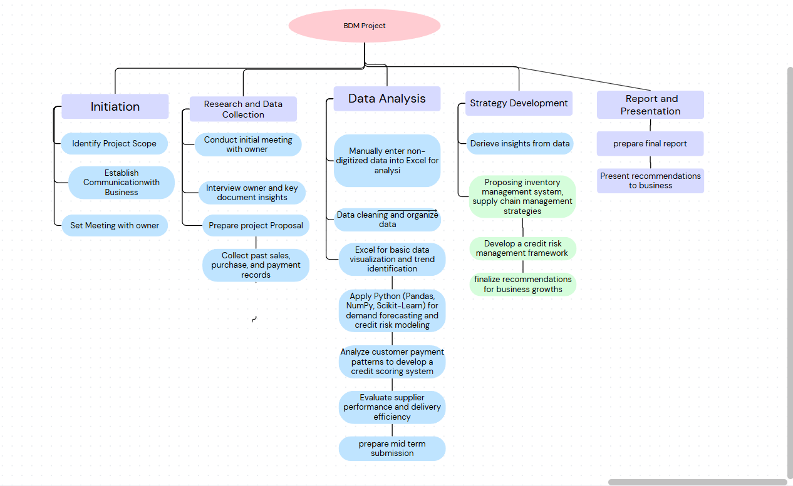
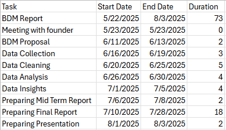
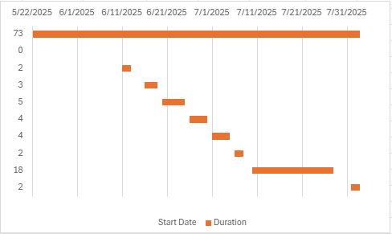

# Optimizing Retail Operation for BLS Amar Communication and Online Services: A Data-Driven Business Development Approach

### A Proposal report for the BDM capstone Project

**Submitted by**  
Name: Sonali Duvesh    

  

IITM Online BS Degree Program,  
Indian Institute of Technology, Madras, Chennai  
Tamil Nadu, India, 600036  

---

## Contents

1. Executive Summary and Title
2. Organization Background
3. Problem Statement (Listed as objectives)  
   3.1 Problem statement 1  
   3.2 Problem statement 2  
   3.3 Problem statement 3  
4. Background of the Problem (200 Words)
5. Problem Solving Approach (400 Words)
6. Expected Timeline
7. Expected Outcome

---

## Declaration Statement

I am working on a Project Title “Optimizing Retail Operations for BLS Amar Communication and Online Services: A Data-Driven Business Development Approach”. I extend my appreciation to BLS Amar Communication and Online Services, for providing the necessary resources that enabled me to conduct my project.

I hereby assert that the data presented and assessed in this project report is genuine and precise to the utmost extent of my knowledge and capabilities. The data has been gathered through primary sources and carefully analyzed to assure its reliability. Additionally, I affirm that all procedures employed for the purpose of data collection and analysis have been duly explained in this report. The outcomes and inferences derived from the data are an accurate depiction of the findings acquired through analytical procedures.

I am dedicated to adhering to the information of academic honesty and integrity, and I am receptive to any additional examination or validation of the data contained in this project report.

I understand that the execution of this project is intended for individual completion and is not to be undertaken collectively. I thus affirm that I am not engaged in any form of collaboration with other individuals, and that all the work undertaken has been solely conducted by me. In the event that plagiarism to accept disciplinary measures imposed by the relevant authority.

I agree that all the recommendations are business-specific and limited to this exclusively, and cannot be utilized for any other purpose with an IIT Madras tag. I understand that IIT Madras does not endorse this/

---

**Signature of canditate:**  

**Name:** Sonali Duvesh  
**Date:** 13 June 2025  

---

## 1. Executive Summary and Title

This BDM Capstone Project focuses on identifying and addressing operational challenges faced by BLS Amar Communication and Online Services, a local retail store based in India that deals in consumer electronics such as mobile phones, keyboards, and computer accessories, along with a small segment of stationery items. Despite the increasing demand for electronics, the store faces several challenges that impact its growth and profitability.

Key issues include inefficient inventory management, inconsistent demand forecasting, and declining customer retention. The store experiences frequent stockouts of high-demand products and overstocking of slow-moving items, leading to revenue loss and increased holding costs. Moreover, the absence of structured customer relationship practices results in missed opportunities for repeat business and customer loyalty.

To overcome these problems, the project will utilize data collected from the store to perform demand analysis, customer segmentation, and sales trend evaluations. Tools such as Excel, SQL, and visualization dashboards will support this analysis. Proposed solutions include implementing ABC inventory analysis, automated stock tracking systems, and digital loyalty programs.

The expected outcomes of this project include reduced inventory mismatches, improved customer engagement, and increased profitability. These strategies aim to support long-term growth, operational efficiency, and a stronger market position for BLS Amar Communication.

---

## 2. Organisation background

BLS Amar Communication and Online Services was established in 2018 by Mr. Khajan Singh in Vasudha Colony, Barari-Ole Road, Barari, Mathura, Uttar Pradesh. Operating as a B2C retail business, the store specializes in a range of consumer electronics, including mobile phones, keyboards, computer accessories, and related products. It also maintains a limited but essential inventory of stationery items to cater to the day-to-day needs of the local customer base.

The business has been serving the community for over 6 years and has built a reputation for offering affordable, accessible, and quality electronics. The store is managed by Mr. Khajan Singh and his two sons, forming a close-knit team that handles all operational aspects such as procurement, sales, customer service, and inventory management. Being a family-run business, it focuses on personalized service, customer trust, and local market understanding. The data for this project was provided by Mr. Khajan Singh.

---

## 3. Problem Statement

### 3.1 Inventory Management Inefficiencies:
BLS Amar Communication struggles with unorganized inventory, often overstocking slow-moving items while running out of in-demand products. This results in tied-up capital, missed sales, and unhappy customers due to poor demand forecasting.

### 3.2 Inconsistent Sales and Customers Retention:
The store faces irregular sales and few repeat customers due to the lack of a customer engagement strategy or loyalty program. This weakens long-term relationships and affects its ability to compete with larger, tech-savvy retailers.

### 3.3 Limited Digital Integration and Market Visibility:
Despite being in a growing market, the business lacks digital tools for marketing and customer feedback. This limits its reach, reduces customer insights, and hampers long-term growth and visibility.

---

## 4. Background of the Problem

BLS Amar Communication and Online Services, a retail shop located in Barari, Mathura, has been serving local customers since 2018 with a range of electronics and some stationery items. Despite a steadily growing demand for electronic goods, the business is currently facing several internal and external challenges that hinder its overall performance and growth potential.

One of the core issues is poor inventory management. The absence of a structured tracking system results in overstocking of low-demand items and frequent stockouts of fast-moving products. This not only ties up capital but also leads to missed sales opportunities and customer dissatisfaction. Additionally, without a reliable method of analyzing sales patterns, the shop struggles to forecast demand accurately, making stock planning inefficient.

Another concern is the lack of customer engagement tools. The store operates without loyalty programs or digital communication channels, resulting in weak customer retention and irregular sales. In today’s competitive retail environment, such gaps make it difficult to compete with more organized or tech-enabled sellers.

Externally, rising competition, changing consumer preferences, and limited digital visibility further challenge the store’s ability to grow. These issues highlight the need for data-driven strategies focused on improving inventory control, customer engagement, and digital integration to ensure long-term sustainability and profitability.

---

## 5. Problem Solving Approach

To address the key challenges faced by BLS Amar Communication and Online Services, a structured and data-driven approach will be adopted. This approach focuses on three primary areas: inventory management, credit risk assessment, and supplier performance. The objective is to enhance operational efficiency, improve cash flow, and support sustainable business growth.

### Methodology Used

#### 1. Inventory Analysis:
A historical review of sales data will be conducted to identify fast-moving and slow-moving items. This analysis will help minimize overstocking of less popular products and prevent stockouts of in-demand items. Using basic inventory metrics and ABC classification, we can prioritize products based on their sales volume and value contribution, ensuring smarter purchasing decisions and better inventory turnover.

#### 2. Credit Risk Assessment:
To reduce delayed payments and financial risks, a simple credit scoring model will be developed based on customer payment history. By tracking credit sales and flagging high-risk customers, the business can introduce better control over who gets credit and on what terms. Regular follow-ups and payment reminders will be systemized to improve cash recovery and overall financial health.

#### 3. Supplier Performance Evaluation:
Analyzing supplier data-such as delivery timeliness, consistency in quality, and order accuracy-will help identify reliable partners. This ensures that restocks are timely and product quality is maintained, reducing customer complaints and delays in service.

### Data Collection and Preprocessing
The data used in this project includes manually recorded sales transactions, credit sales details, and supplier logs. Since the store does not currently use digital systems, these records will be entered into Excel spreadsheets from physical registers and basic POS receipts. The data spans from June 2024 to December 2024, offering a recent and relevant sample for analysis.
- **Sales Data** - To understand product trends, seasonal patterns, and revenue contributors.
- **Customer Payment Records** - To track credit behavior and evaluate risk.
- **Supplier Data** - To assess reliability and streamline restocking processes.

### Tools for Analysis
- **MS Excel** will be used for initial data entry, cleaning, and basic analysis, including pivot tables and trend charts.
- **Python (Pandas, NumPy, Scikit-Learn)** will assist in more advanced data analysis such as credit risk modeling and inventory forecasting.
- **Tableau** will be used for interactive dashboards, enabling visual insights into sales performance, stock levels, and customer payment behavior.

Through these methods, the project aims to develop actionable insights that will significantly improve store efficiency, customer satisfaction, and long-term profitability.

---

## 6. Expected Timeline

### Work Breakdown Structure

### BDM Project Expected Timeline

### Gantt chart

---

## 7. Expected Outcome

### i. Improved Inventory Efficiency:
Through analysis of historical sales trends, the store will be able to optimize stock levels-ensuring that high-demand products are always available while reducing overstocking of slow-moving items. This will help free up tied capital, minimize storage costs, and reduce the risk of product obsolescence.

### ii. Smarter Credit Risk Management:
By introducing a basic credit scoring and tracking system, the business can better evaluate customer payment behavior. This will reduce the occurrence of delayed or default payments, improve cash flow, and allow more informed credit extension decisions in the future.

### iii. Streamlined Supplier Coordination:
Assessing supplier performance will allow the business to prioritize reliable vendors, resulting in fewer delays and improved consistency in product quality. This will strengthen customer trust and enable timely restocking, leading to better service delivery.

### iv. Enhanced Customer Engagement and Retention:
With insights into sales behavior and credit history, the business can begin to identify repeat customers and implement loyalty strategies. Improved service, timely product availability, and transparent credit practices will boost customer satisfaction and retention.

### v. Sustainable Growth and Profitability:
Overall, the proposed improvements in inventory, credit, and supplier management will lead to more stable operations, increased profitability, and a stronger market position-setting the stage for long-term business growth.
