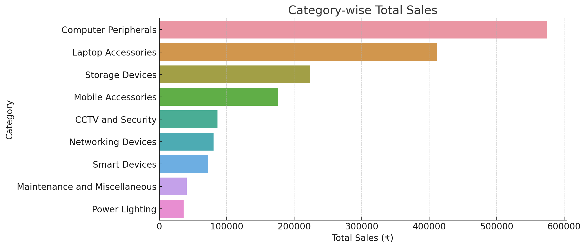
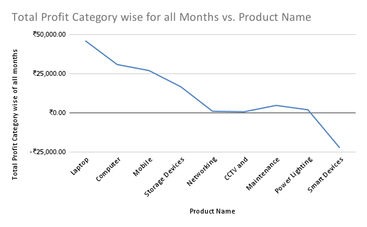
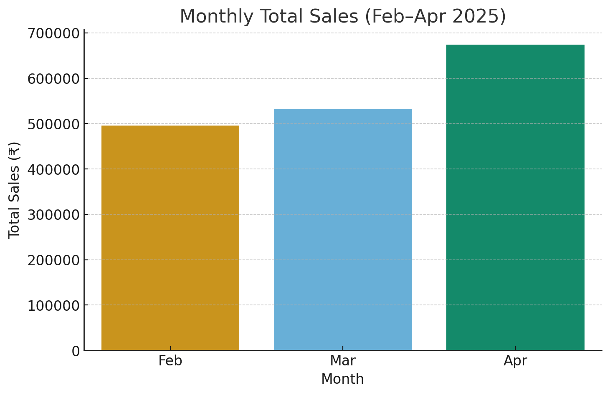
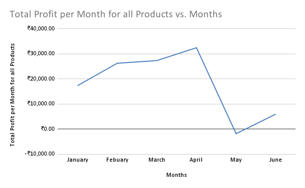
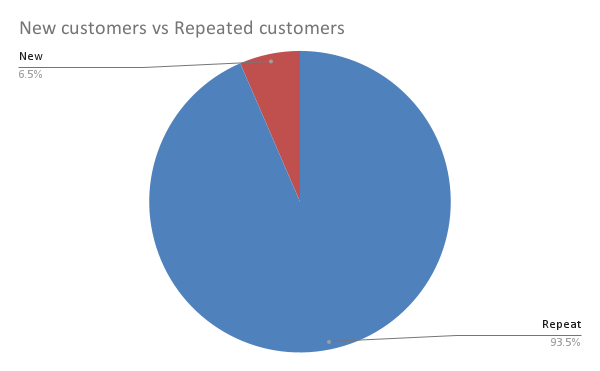

# Business_Data_Management_Capstone_Project - Retail Operations & Inventory Analytics
### *A Data-Driven Business Analytics & Demand Forecasting Framework*

[](https://www.python.org/)
[](https://pandas.pydata.org/)
[](https://scikit-learn.org/)
[](https://www.statsmodels.org/)
[](#license)
[](#)

---

## Executive Summary

This project delivers an **end-to-end commercial analytics framework** designed to optimize retail operations, stabilize cash flow, and enhance profitability for **BLS Amar Communication & Online Services**-a regional electronics and consumer technology retailer.

By converting fragmented, handwritten store ledgers into structured analytical pipelines, this study tackles primary operational bottlenecks: **inventory misallocation, unhedged dead stock, seasonal demand volatility, and single-channel customer reliance**.

Through **ABC Inventory Stratification**, **ARIMA (1,1,1) Time-Series Forecasting**, and **K-Means Behavioral Segmentation**, the project establishes a concrete, data-backed operational blueprint to protect margins and accelerate business expansion.

```text
       525+                 ₹107.6K+                 71.7%                  93.5%
Transactions Digitized   Net Profit Analyzed   Profit from Top 2 Categories   Customer Loyalty Core
```

---

## Business Problem & Core Objectives

Retail operations often face capital entrapment due to intuitive rather than data-driven procurement. Prior to this intervention, the business faced three critical challenges:

| Operational Challenge | Business Impact | Analytical Solution Applied |
| :--- | :--- | :--- |
| **Inventory Imbalance** | Critical stockouts of fast movers alongside capital entrapment in stagnant stock. | **ABC Inventory Classification** based on net gross profit contribution. |
| **Demand Volatility** | Reactive reordering led to supply crunches during festivals and excess stock post-season. | **ARIMA (1,1,1) Time-Series Forecasting** to establish dynamic reorder thresholds. |
| **Customer Acquisition Bottleneck** | Over-reliance on existing footfall without scalable customer acquisition systems. | **K-Means Clustering** & retention analysis to build acquisition campaigns. |

---

## Technical Stack & Methodologies

* **Data Engineering & ETL:** Data normalization, missing-value imputation, feature derivation (Gross Margin, COGS, Repeat Customer Index, Item Availability Flags) using **Python (Pandas, NumPy)** and structured Google Sheets pipelines.
* **Exploratory Data Analysis (EDA):** Multivariate distributions, category-level margin tracking, and financial performance audits using **Matplotlib** and **Seaborn**.
* **Inventory Modeling:**
  * **ABC Stratification:** Categorization of catalog items by cumulative profit yield.
  * **Efficiency Metrics:** Days Sales of Inventory (DSI), Stock-to-Sales Ratio (SSR), and Inventory Turnover Ratio (ITR).
* **Predictive Modeling:** **ARIMA (1,1,1)** univariate time-series modeling for quarterly sales demand forecasting.
* **Customer Analytics:** **K-Means Clustering** unsupervised learning to segment transaction frequency and basket value.

---

## Key Insights & Visual Analytics

### 1. Revenue Volume vs. Net Profit Reality (The ABC Disconnect)
Evaluating sales revenue in isolation can be misleading. While categories like Computer Peripherals and Laptop Accessories led gross sales, our ABC classification revealed severe margin skewness:

* **Class A (Core Margin Drivers):** `Laptop Accessories` (₹46,200 / 42.9%) and `Computer Peripherals` (₹31,000 / 28.8%) generated **71.7% of total net profits**.
* **Class B (Steady Anchors):** `Mobile Accessories` (₹27,150) and `Storage Devices` (₹16,800) contributed predictable recurring income.
* **Class C (The Capital Trap):** `Smart Devices` recorded a **net loss of ₹–22,300**, exposing severe holding costs, stock obsolescence, and margin erosion.

<p align="center">
  
  <br><em>Figure 1: Gross Sales Volume by Product Category</em>
</p>

<p align="center">
  
  <br><em>Figure 2: Net Profit Contribution & Loss Distribution Across Categories</em>
</p>

---

### 2. Seasonality & Margin Compression (Monthly Trends)
Over the 6-month observation period (926 total units sold), customer activity demonstrated distinct seasonal cyclicality:

* **Growth & Peak:** Sales expanded +67% from January (110 units / ₹17,350 profit) to March (184 units) and April (183 units / ₹32,475 profit), fueled by academic sessions and local festival buying.
* **Post-Peak Margin Drop:** In May, despite steady transaction volume (159 units), the store incurred a **net loss of –₹1,800** due to heavy promotional markdowns and excess stock holding costs, before recovering in June (133 units / ₹6,000 profit).
* **Predictive Value (ARIMA):** Applying ARIMA (1,1,1) establishes dynamic safety stock buffers that prevent pre-peak stockouts while restricting post-peak over-procurement.

<p align="center">
  
  <br><em>Figure 3: Monthly Sales Trajectory Across the Observation Window</em>
</p>

<p align="center">
  
  <br><em>Figure 4: Net Monthly Profit & Vulnerability Analysis (Highlighting May Contraction)</em>
</p>

---

### 3. Customer Retention vs. Acquisition Plateau
Transaction log analysis covering February to April revealed a stark customer acquisition reality:

* **93.5% Repeat Customer Base:** Demonstrates high organic trust, reliable customer satisfaction, and strong repeat footfall.
* **6.5% New Customer Inflow:** Highlights a critical growth ceiling caused by the absence of proactive outreach, referral loops, or digital discovery channels.

```text
  Repeat Customers (93.5%)  [=============================================]  (High Trust / Stable Base)
  New Acquisitions (6.5%)   [===]                                            (Growth Bottleneck)
```

<p align="center">
  
  <br><em>Figure 5: Customer Base Composition (Repeat Retention vs. New Inflow)</em>
</p>

---

## Strategic Roadmap & Implementation Plan

Based on empirical findings, four operational pillars were established:

### 1. Dynamic Stock Allocation & Reorder Triggers
* **Double Down on Class A:** Maintain a guaranteed 15-day rolling safety stock for Laptop Accessories and Peripherals.
* **Phase Out Capital Drains:** Enforce an immediate liquidation protocol for stagnant Smart Devices (bundle pricing, clearance discounts) to liberate trapped capital.

### 2. Predictive Procurement Cycle
* Synchronize supplier purchase orders with ARIMA quarterly demand forecasts, timing bulk procurement 3–4 weeks prior to peak academic cycles (February–March) to negotiate wholesale volume discounts.

### 3. Customer Acquisition & Loyalty Funnel
* **Referral Loops:** Deploy peer-referral discount vouchers targeting local university and school students to break the 6.5% acquisition bottleneck.
* **Tiered Loyalty:** Introduce SMS-based repeat milestone perks for top-tier spenders identified through K-Means clustering.

### 4. Low-Cost Digital Infrastructure
* Transition from manual register bookkeeping to an automated, lightweight POS & inventory monitoring sheet, enabling live dashboard tracking of Daily Sales of Inventory (DSI) and gross margins.

---

## Repository Architecture

```text
├── README.md                      # Executive Project Brief & Commercial Analysis
├── LICENSE                        # Proprietary License (All Rights Reserved)
├── Final Report.md                # Comprehensive Technical Capstone Report
├── Mid Term Report.md             # Mid-Term Analysis & Data Pipeline Architecture
├── Proposal Report.md             # Initial Business Case, WBS & Methodology
├── assets/                        # High-resolution analytical charts featured in README
│   ├── category_profit_distribution.png
│   ├── category_total_sales.png
│   ├── customer_retention.png
│   ├── monthly_profit_trend.png
│   └── monthly_sales_trend.png
└── images/                        # Visual assets embedded across markdown reports
    ├── final_report/
    ├── mid_term/
    └── proposal/
```

---

## Detailed Reports

For complete technical specifications, underlying formulas, and statistical proofs:
* **[Final Comprehensive Report](Final%20Report.md)**: Full exploratory statistics, ARIMA specifications, formulas, and category breakdown.
* **[Mid-Term Milestone Report](Mid%20Term%20Report.md)**: Metadata structure, data transformation steps, and preliminary findings.
* **[Project Proposal & Roadmap](Proposal%20Report.md)**: Problem formulation, Work Breakdown Structure (WBS), and risk management.

---

## Author & Contact

**Sonali Duvesh**  
*Data & Business Analytics Practitioner*  

Specialized in retail operations analytics, supply chain optimization, and predictive decision frameworks. Open to roles in **Business Analytics, Data Analytics, Revenue Operations, and Business Intelligence**.

---

## License

Copyright (c) 2025-2026 Sonali Duvesh. All rights reserved.

This repository and all associated analytical materials, reports, methodologies, and visual assets are proprietary. No part of this work may be copied, redistributed, or used commercially without explicit written consent from the author. See [LICENSE](LICENSE) for full legal terms.
